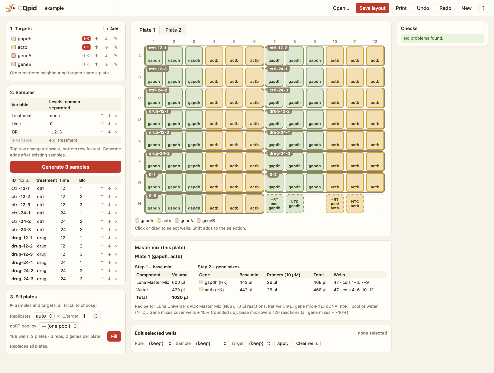

# CQpid

Plan qPCR plates in a few clicks: CQpid lays out your samples and genes on 96-well plates, works out the master-mix volumes, and prints a bench sheet for easy pipetting.

## How to use
Either download the html or access at (tbd).
1. **Targets:** add your target genes (primers); mark reference genes with **HK** flag.
2. **Samples:** type your variables and levels (e.g. treatment `ctrl, drug`, time `12, 24`; biological replicates 1–3 are pre-filled), then **Generate**.
	1. If your samples already are in some specific order, use that order for creating samples.
3. **Fill:** creates the plate layout.
4. **Print** the bench sheet and **Save layout** (a CSV of the plates; can be uploaded with "Open" to restore a session).
## How plates are laid out
- All wells per cDNA are kept in one row or column for easy pipetting.
- If multiple plates are needed, it splits by gene (not sample).

Details: [`app/README.md`](app/README.md). 
File format: [`spec/layout_format.md`](spec/layout_format.md).
## Master mix
The volumes are for **Luna Universal qPCR Master Mix (NEB), 10 µl reactions** (5 µl Luna, 0.5 µl of pooled 10 µM primers, 1 µl template, water to 10 µl). For another mix, edit the `MIX` line near the top of `cqpid.html`.
## License
MIT
## AI disclosure
This is a small convenience project, and all code was written by Claude Opus 5.5. I tested the app and it works for my purposes, but for obvious reasons, I cannot guarantee it works flawlessly in all scenarios. 
